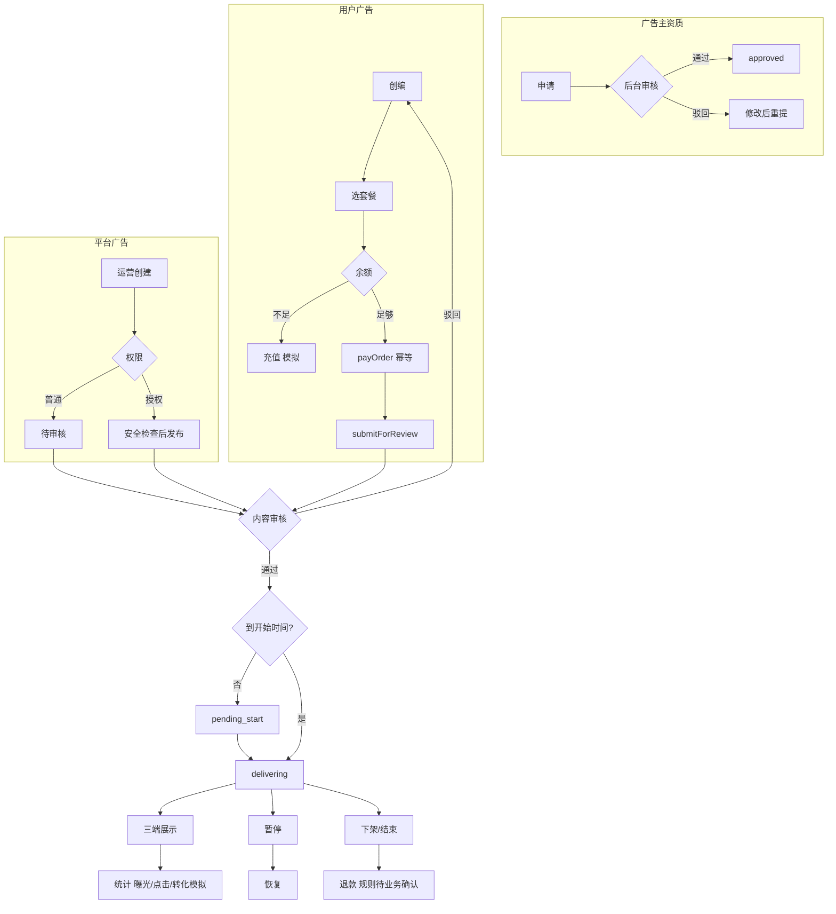

# 广告系统一期 · 需求说明

> 与仓库内 HTML 原型一致：`admin-prototype/ads-*`、`pages/ad-*`、`pages-web/ad-*`。  
> 数据：`localStorage` **`fl_ad_system_v2`**（重置：`localStorage.removeItem('fl_ad_system_v2')`）。  
> 脚本：`js/ad-system-store.js`（模型）· `js/ad-system-api.js`（规则）· `js/ad-system-user.js`（用户端 UI）。

---

## 一、项目背景与建设目标

在现有直播社交平台中**增量**建设广告能力，不重建产品、不改动无关模块。支持 **广告主自主投放** 与 **平台运营投放**，共用审核、投放、展示与统计。

一期采用 **固定套餐**（按广告位 + 购买周期收费），广告主须 **申请资质并审核通过** 后方可购买套餐并发布付费广告。原型使用模拟数据；支付、审核、投放、到账等未接入真实服务处均在交互中标注为演示。

---

## 二、一期范围与非范围

| 包含 | 不包含 |
|---|---|
| 三端可交互原型、广告主准入、7 步创编、套餐订单、模拟支付/退款 | 实时竞价（RTB）、动态 CPM/CPC 扣费 |
| 审核与内容版本、三广告位展示、后台运营/套餐/资质/财务/统计/风控 | 复杂人群画像 DMP、强制插播视频广告 |
| 独立状态机、异常场景演示、操作/资金流水（只增不改） | 真实支付清算与对账接口 |

---

## 三、现有项目集成说明

| 类别 | 说明 |
|---|---|
| **复用** | 后台 `admin-shell` / `admin-nav` / `AdminModal`；H5 `common.css`；WEB `common-web.css` |
| **新增页面** | 用户：广告能力内嵌 **`settings-ad.html`**（H5 `pages/`、WEB `pages-web/`，设置壳内多视图：中心/创建/详情/数据/账户/资质）；旧 `ad-*.html` 仅跳转；后台：`admin-prototype/ads-index.html`、`ads-*` |
| **局部修改** | `home.html` / `pages-web/home.html` 增加展示脚本；`live-detail.html` 直播推广条；Profile/侧栏/设置 **仅增**「广告中心」入口 |
| **展示关闭** | 移除 `home.html` 内 `ad-system-display*.js` 引用即可 |

---

## 四、涉及的端、角色与权限

| 端 | 用户 | 职责 |
|---|---|---|
| 后台 WEB | 运营、审核、财务、风控 | 概览、列表、审核、运营创编、广告位/套餐、广告主与资质、资金、统计、风控 |
| 用户 H5 | 普通用户 / 广告主 | 广告展示与反馈、广告中心、创编、账户、数据 |
| 用户 WEB | 同上 | **业务能力、字段、状态、规则与 H5 一致**，仅布局适配桌面 |

| 角色 | 能力（一期） |
|---|---|
| 普通用户 | 浏览广告、不感兴趣/举报；**无广告主资格不可购套餐、不可创编** |
| 广告主 | 同一 `uid` 可申请并挂载广告主身份；通过后创编、套餐支付、管理广告、查看**自有**资金与统计 |
| 后台 | 分模块操作；原型用 `localStorage.fl_ad_admin_role`（`operator` / `finance` / `super`）模拟越权拦截（如改套餐价需 `super`） |

**产品原则（一期）：** 任意登录用户**可申请**成为广告主，但**付费投放仅对已审核通过的广告主（及后台平台运营）开放**；与创作者发内容、普通用户消费内容分离。

数据隔离（原型）：演示账号 `U102938` 仅见自有广告、订单与流水。

---

## 五、三端页面清单

### 5.1 后台（菜单：广告管理）

| 文件 | 功能 |
|---|---|
| `ads-overview.html` | 总量、待审、投放中、消耗与趋势（演示数据） |
| `ads-list.html` | 搜索筛选、详情、暂停/恢复/下架 |
| `ads-review.html` | 待审队列；通过/驳回（**驳回必填原因**） |
| `ads-ops-create.html` | 平台广告；草稿/提审/授权发布 |
| `ads-slots.html` | 广告位规格、间隔、启停 |
| `ads-packages.html` | 固定套餐价格与可售状态；改价记日志，**不影响历史订单 priceSnapshot** |
| `ads-advertiser-qual.html` | 广告主资质审核 |
| `ads-advertisers.html` | 广告主列表、限制发布（演示） |
| `ads-finance.html` | 余额、冻结、流水（只读） |
| `ads-stats.html` | 汇总、明细、导出演示 |
| `ads-risk.html` | 举报/异常流量、联动暂停 |
| `ads-index.html` | iframe 平铺评审 |

### 5.2 用户 H5 / WEB（路径对应）

| 能力 | H5 | WEB |
|---|---|---|
| 广告中心 | `pages/ad-center.html` | `pages-web/ad-center.html` |
| 创建广告（7 步） | `pages/ad-create.html` | `pages-web/ad-create.html` |
| 详情 / 数据 | `ad-detail.html` / `ad-stats.html` | 同名校 |
| 广告主申请 | `ad-advertiser-apply.html` | `pages-web/ad-advertiser-apply.html` |
| 广告账户 | `ad-wallet.html` | `pages-web/ad-wallet.html` |
| 信息流 / Banner | `js/ad-system-display.js` + `home.html` | `js-web/ad-system-display-web.js` + `home.html` |
| 直播间推广卡 | `js/ad-system-display-live.js` + `live-detail.html` | 同逻辑（WEB 直播页可按需挂载） |

**创编步骤**：基础信息 → 素材 → 广告位与落地 → 投放时间与地域/语言 → **套餐** → **支付** → **提交审核**。

### 5.3 用户广告中心 · 信息架构（`settings-ad` / 设置内嵌 `#settingsAdPanel`）

入口：设置侧栏「广告中心」（`data-ad-nav="1"`）→ Web 内嵌 `js-web/settings-ad-embed.js` + `js/ad-system-user.js`；H5 独立 `pages/settings-ad.html`。单页多视图：`center` · `create` · `detail` · `stats` · `wallet` · `apply`（`ad-settings-shell.js`）。

**界面原则：** 产品页不展示长篇规则/流程说明（写在本文档）；页内仅用状态标签、数字、按钮、Toast 表达可执行信息与拦截原因。

| 区块 | 说明 |
|---|---|
| 身份标签 | `#adRoleStrip` 单行 pill（无副文案） |
| 资质条 | `#adQualBanner`：短状态 + 必要操作；驳回可带 `rejectReason` |
| 工具栏 | **创建广告**（仅 `approved`）· **广告账户** · **申请广告主** |
| 账户与投放概览 | 余额、冻结、投放中、待审核、待支付；曝光/点击/消耗 |
| 我的广告 | 筛选 + 列表；空态「暂无广告」 |

用户侧仅管理**来源 `user`** 的广告与自有流水；平台广告在 `ads-ops-create.html`。

---

## 六、核心实体与字段（摘要）

| 实体 | 要点 |
|---|---|
| **Advertiser** | `uid`、`accountStatus`、申请信息、驳回原因、违规次数 |
| **Ad** | 来源 `user`/`platform`、素材/文案/链接、`auditStatus`、`payStatus`、`deliveryStatus`、`contentVersion`、`versions[]` |
| **Order** | `priceSnapshot`（下单时套餐价）、支付/退款状态、幂等键 |
| **Package** | 广告位、时长、现价、`enabled`；历史订单不随改价变化 |
| **FinanceLedger** | 充值/购买/退款；唯一单号；**不可删改**（原型） |
| **Risk / OpLog** | 异常事件、操作人/时间/原因 |

**校验（原型已实现）**：必填项；链接禁 `javascript:`、风险域名拦截；**支付成功后才可** `submitForReview`；敏感字段变更触发 **新版本 + 重新审核**。

---

## 七、广告位与素材规范

| 编码 | 位置 | 素材 | 标识 |
|---|---|---|---|
| `feed_video` | 短视频信息流 | 9:16 或 1:1 图/视频 | 「赞助」 |
| `home_banner` | 首页 Banner 区 | 16:9 静图 | 「广告」 |
| `live_room` | 直播画面下、互动区上 | 小卡 / 横条 | 「广告」 |

不得伪装成 UGC；不得点击空白区域隐藏跳转。暂停/下架/到期后展示组件应同步停止（原型：`fl-ad-store-changed` 刷新）。

---

## 八、业务流程图

### 8.1 总览（资质 · 创编 · 审核 · 投放）

### 8.2 用户自主 vs 运营（汇入点）

两条发布路径均在 **内容审核** 与 **支付/投放条件** 处汇合；平台广告 `payStatus` 可为 `none`，用户广告必须 `paid` 方可进入投放链。

---

## 九、状态定义（分字段维护）

UI 可组合展示（如「审核通过 · 待开始」），**底层不得混为单一状态**。

| 域 | 枚举（代码键） |
|---|---|
| **审核** | `draft` · `pending_review` · `approved` · `rejected` · `revoked` |
| **支付** | `unpaid` · `processing` · `paid` · `failed` · `refund_processing` · `partial_refunded` · `refunded` · `refund_failed` · `none`（平台） |
| **投放** | `pending_start` · `delivering` · `paused` · `ended` · `removed` |
| **广告主账号** | `pending` · `approved` · `rejected` · `restricted` · `disabled` |

### 9.1 状态转换限制（摘要）

- 未支付 → 不可提审、不可投放。  
- 未审核通过 → 不可投放。  
- 驳回 → 须修改后重审，不可直接开播。  
- 审核通过后修改素材/文案/落地链 → **新版本** + `pending_review`，旧通过状态不延续。  
- `ended` / `removed` → **不可直接恢复投放**（需新建广告或新业务规则，待确认）。  
- 退款总额 ≤ 订单可退金额；重复退款请求幂等。  
- 账号 `restricted` / `disabled` → 不可创建或恢复投放。  
- 不允许的操作由 API 返回 **明确中文原因**（`js/ad-system-api.js`）。

### 9.2 套餐、排期与计费口径

- **套餐（Package）**：广告位 + 周期天数 + 一口价 USDT；下单时 `priceSnapshot` 快照，改价不影响历史订单。  
- **排期**：用户填写 **开始时间**；**结束时间 = 开始 + 套餐 `durationDays`**（创编第 5 步选套餐后自动写入，支付/提审前校验，允许 ±2 分钟误差）。  
- **投放窗口**：仅在 `[startAt, endAt]` 且审核通过、已支付、`delivering`/`paused` 等状态下展示；**不按曝光/点击二次扣费**（一期一口价）。

### 9.3 资金字段与退款公式（已定 · 原型 `FLAdService.computeRefundQuote`）

**账户字段**：**可用余额**、**冻结**、**已消费**（净消耗，退款会回冲 `spent`）、**已退款**。  
**订单字段**：**实付** `paidAmount`、**累计已退** `refundedAmount`、**当前可退上限** `refundableAmount`（随时间重算）。

**未开投**（`pending_start` 且当前时间 **早于** `startAt`）：

- 已消耗天数 \(D_{\mathrm{used}} = 0\)，手续费 **0%**  
- 可退上限 = **实付 − 累计已退**（全额退，幂等）

**已开投**（`delivering` / `paused`，或已进入投放周期）：

- 套餐天数 \(D =\) 订单 `durationDays`（如 7）  
- 已消耗天数（**向上取整**）：自 `startAt` 起至「当前时刻与排期结束较早者」，按 **86400000 ms/天** 取 \(\lceil \cdot \rceil\)，且 \(D_{\mathrm{used}} \le D\)  
- 剩余天数 \(D_{\mathrm{rem}} = \max(0,\, D - D_{\mathrm{used}})\)  
- 手续费率 \(f =\) **`REFUND_SERVICE_FEE_RATE`（原型默认 5%）**  
- **可退上限（累计）**：

\[
R_{\max} = \mathrm{round}\Bigl(\mathrm{实付} \times \frac{D_{\mathrm{rem}}}{D} \times (1 - f),\, 2\Bigr)
\]

- **本次最多可退** = \(\max(0,\, R_{\max} - \mathrm{已退})\)；退款后若无可退余量，广告 **下架**（`removed`）。

**示例**：实付 199 USDT，7 天套餐，已消耗 4 天（向上取整后），\(f=5\%\) → \(R_{\max} = 199 \times (3/7) \times 0.95 \approx 80.93\) USDT。

**暂停**：停止展示，**不自动退款**；剩余天数仍按上式随日历推进。  
**未支付**：取消订单即可，不走退款流。  
**ended / removed**：\(D_{\mathrm{used}} = D\)，一般无可退（除非运营人工调账，后台另议）。

---

## 十、统计、风控与审计

- **统计**：曝光、点击、CTR；进房等转化仅展示 **可追踪且原型标注为模拟** 的数据；异常点击在 `risk` 中标记，**不计入有效效果**（演示口径）。  
- **风控**：素材/链接风险、异常点击、举报；支持暂停/下架/限制广告主。  
- **审计**：关键操作写入 `opLogs`；资金流水只追加，运营不可改删（原型）。

---

## 十一、三端一致性

| 维度 | 要求 |
|---|---|
| 创编字段与步骤顺序 | H5 = WEB |
| 状态枚举与流转 | 共用 `FLAdStore` + `FLAdService` |
| 列表/详情可操作按钮 | 同状态同权限；后台多运营能力 |
| 同一广告统计数字 | 同源 localStorage，H5/WEB 一致 |
| 布局 | H5 单列；WEB 双栏/表格；后台 Ant Design |

---

## 十二、交互与安全异常（原型覆盖）

| 场景 | 预期行为 |
|---|---|
| 越权改套餐价 | 非 `super` 角色拦截并提示 |
| 恶意链接 / 不合规 URL | 提交拦截并说明 |
| 重复点击支付/退款 | 幂等，不重复扣款 |
| 支付失败 | 可重试；状态 `failed` |
| 余额不足 | 提示差额，引导 `ad-wallet` 模拟充值 |
| 下架/暂停 | 列表与 Feed/Banner/直播卡同步更新 |
| 危险操作 | 二次确认（`confirm` / `AdminModal`） |
| 审核驳回 | 必填原因；广告主可见并重提 |

---

## 十三、验收与端到端测试（原型自测）

| # | 场景 |
|---|---|
| 1 | 申请广告主 → 后台通过 → 创编 → 支付 → 提审 → 审核通过 → 展示 |
| 2 | 审核驳回 → 查看原因 → 修改 → 重审 |
| 3 | 余额不足 → 充值 → 再支付 |
| 4 | 投放中暂停 → 恢复（含失败提示用例） |
| 5 | 待开始 + 已付 → 全额退（无手续费）→ 流水一致 |
| 5b | 投放中第 4 天 → 申请退款 → 按剩余 3/7 天 × (1−5%) 计算 |
| 6 | 通过后改素材 → 版本 +1、重审 |
| 7 | 重复支付同一订单 |
| 8 | 运营改套餐价 vs 历史订单快照 |
| 9 | 下架后首页广告消失 |
| 10 | 无资质/受限账号创编被拦截 |
| 11 | 风险域名链接被拦截 |

---

## 十四、模拟能力与真实服务边界

| 能力 | 原型 |
|---|---|
| 支付 / 退款 | 本地延迟 + 幂等 Map，非 PSP/链上 |
| 审核 / 投放服务 | 后台按钮 + localStorage |
| 曝光 / 点击 / 转化 | 种子 + 「模拟」文案 |
| 权限 | `fl_ad_admin_role` 切换 |

刷新页面后状态保持（localStorage）；清键后恢复种子数据。

---

## 十五、待业务确认事项

以下影响研发与财务方案，**不得写死为已确定规则**；原型中用配置项或「待业务确认」文案占位。

1. 广告主准入材料与 KYC 是否复用现有实名体系。  
2. 违规下架、运营强制下架是否适用同一退款公式；退款 **到账方式/时效**（原型为即时回广告账户）。  
3. 转化事件（进房等）的 **统计口径与去重规则**。  
4. 直播间广告 **频次上限** 与仅运营可投是否长期成立。  
5. 运营 **免人工审核** 白名单范围与安全校验清单。  
6. 地域/语言定向以平台 **真实可用数据** 为准的最终列表。  
7. 真实支付通道、对账与发票流程。

---

## 十六、文档维护

本文档为广告系统 **唯一需求说明入口**；原型迭代时同步更新本章与 `js/ad-system-api.js` 行为，避免多份文档分叉。
