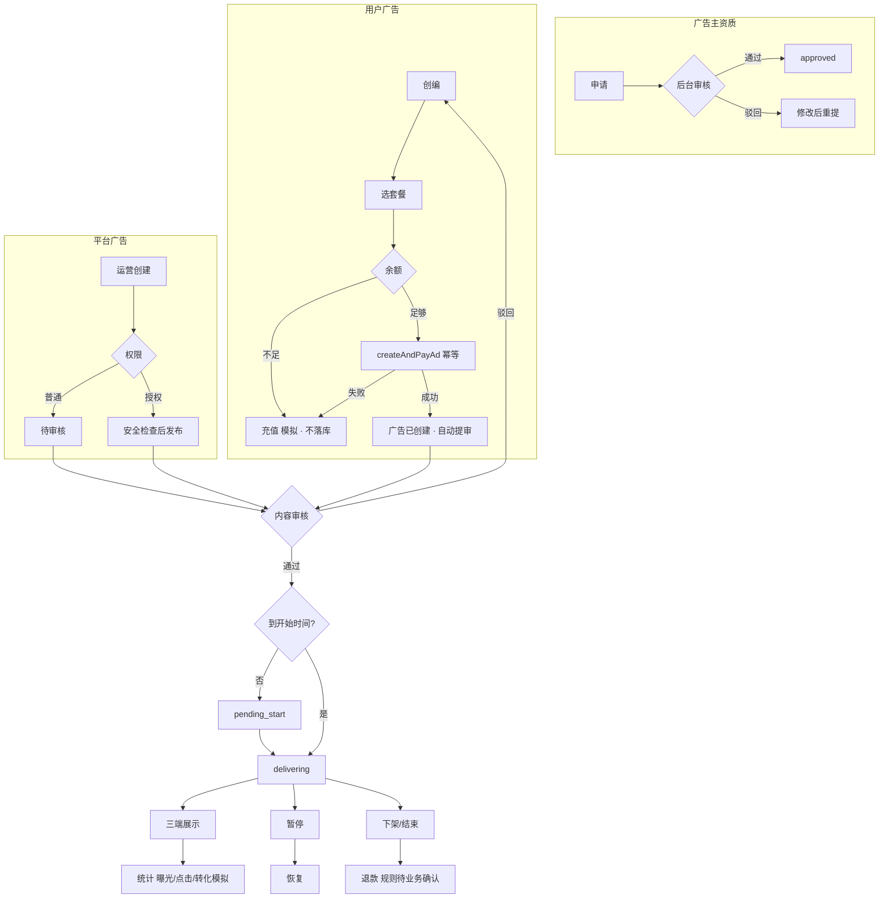
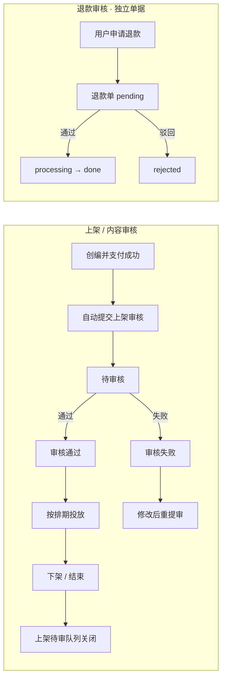

# 广告系统一期 · 需求说明

> 与仓库内 HTML 原型一致：`admin-prototype/ads-*`、`pages/ad-*`、`pages-web/ad-*`。  
> 数据：`localStorage` **`fl_ad_system_v2`**（重置：`localStorage.removeItem('fl_ad_system_v2')`）。  
> 脚本：`js/ad-system-store.js`（模型）· `js/ad-system-api.js`（规则）· `js/ad-system-user.js`（用户端 UI）。

---

## 一、项目背景与建设目标

在现有直播社交平台中**增量**建设广告能力，不重建产品、不改动无关模块。支持 **广告主自主投放** 与 **平台运营投放**，共用审核、投放、展示与统计。

一期采用 **固定套餐**（按广告位 + 购买周期收费），广告主须 **申请资质并审核通过** 后方可购买套餐并发布付费广告。原型使用模拟数据；支付、审核、投放、到账等未接入真实服务处均在交互中标注为演示。

---

## 二、一期范围与非范围

| 包含 | 不包含 |
|---|---|
| 三端可交互原型、广告主准入、7 步创编、套餐订单、模拟支付/退款 | 实时竞价（RTB）、动态 CPM/CPC 扣费 |
| 审核与内容版本、三广告位展示、后台运营/套餐/资质/财务/统计/风控 | 复杂人群画像 DMP、强制插播视频广告 |
| 独立状态机、异常场景演示、操作/资金流水（只增不改） | 真实支付清算与对账接口 |

---

## 三、现有项目集成说明

| 类别 | 说明 |
|---|---|
| **复用** | 后台 `admin-shell` / `admin-nav` / `AdminModal`；H5 `common.css`；WEB `common-web.css` |
| **新增页面** | 用户：广告能力内嵌 **`settings-ad.html`**（H5 `pages/`、WEB `pages-web/`，设置壳内多视图：中心/创建/详情/数据/账户/资质）；旧 `ad-*.html` 仅跳转；后台：`admin-prototype/ads-index.html`、`ads-*` |
| **局部修改** | `home.html` / `pages-web/home.html` 增加展示脚本；`live-detail.html` 直播推广条；Profile/侧栏/设置 **仅增**「广告中心」入口 |
| **展示关闭** | 移除 `home.html` 内 `ad-system-display*.js` 引用即可 |

---

## 四、涉及的端、角色与权限

| 端 | 用户 | 职责 |
|---|---|---|
| 后台 WEB | 运营、审核、财务、风控 | 概览、列表、审核、运营创编、广告位/套餐、广告主与资质、资金、统计、风控 |
| 用户 H5 | 普通用户 / 广告主 | 广告展示与反馈、广告中心、创编、账户、数据 |
| 用户 WEB | 同上 | **业务能力、字段、状态、规则与 H5 一致**，仅布局适配桌面 |

| 角色 | 能力（一期） |
|---|---|
| 普通用户 | 浏览广告、不感兴趣/举报；**无广告主资格不可购套餐、不可创编** |
| 广告主 | 同一 `uid` 可申请并挂载广告主身份；通过后创编、套餐支付、管理广告、查看**自有**资金与统计 |
| 后台 | 分模块操作；原型用 `localStorage.fl_ad_admin_role`（`operator` / `finance` / `super`）模拟越权拦截（如改套餐价需 `super`） |

**产品原则（一期）：** 任意登录用户**可申请**成为广告主，但**付费投放仅对已审核通过的广告主（及后台平台运营）开放**；与创作者发内容、普通用户消费内容分离。

数据隔离（原型）：演示账号 `U102938` 仅见自有广告、订单与流水。

**演示默认身份**：`U102938` 初始为**未申请广告主**（`advertiserStatus: none`），便于走通「申请 → 后台审核 → 创编」；历史 localStorage 会在加载时自动移除该 UID 的资质记录。控制台可重复重置：`FLAdStore.clearAdvertiserQual()`。

### 5.5 广告主申请 · 前置条件与协议（一期）

对齐主流社交/广告平台：**开户先实名与协议，付费投放再充值**（Meta/TikTok 等均为账户审核 + 合规身份，非先交押金）。

| 类别 | 是否必须 | 说明 |
|---|---|---|
| 已登录 | 是 | `goodfans_auth.loggedIn` |
| KYC 已通过 | 是 | `GoodfansKycStore.isApproved()` 或 `goodfans_kyc` / H5 `h5_withdraw_kyc_passed` |
| 投放主体名称 + 联系邮箱 | 是 | 表单必填；主体可为公司、品牌或个人常用名 |
| 勾选《广告主服务协议》 | 是 | 摘要见 `js/ad-advertiser-terms.js`，页内可打开全文弹窗 |
| 广告账户余额 | **否** | 创编选套餐支付时再充值 |
| 押金 / 保证金 | **否** | 一期无 |
| 创作者身份 / 上架商品 | **否** | 与发内容、商城独立；可仅投自有直播/主页 |

未满足时：**提交时** Toast + 引导弹窗（仅列未完成项，「去验证/去登录」）；标题旁 **dev-glass** 气泡为可选说明（`dev-glass-viewport.js` 防裁切）。逻辑：`FLAdService.checkAdvertiserApplyPrerequisites` · `applyAdvertiser`。

---

## 五、三端页面清单

### 5.1 后台（菜单：广告管理）

| 文件 | 功能 |
|---|---|
| `ads-overview.html` | 总量、待审、投放中、消耗与趋势（演示数据） |
| `ads-list.html` | 搜索筛选、详情、暂停/恢复/下架 |
| `ads-review.html` | 待审队列；通过/驳回（**驳回必填原因**） |
| `ads-ops-create.html` | 平台广告；草稿/提审/授权发布 |
| `ads-slots.html` | 广告位规格、间隔、启停 |
| `ads-packages.html` | 固定套餐价格与可售状态；改价记日志，**不影响历史订单 priceSnapshot** |
| `ads-advertisers.html` | 广告主列表、资质通过/驳回、限制发布 |
| `ads-orders.html` | 订单查询、支付/投放/退款状态、支付对账演示 |
| `ads-refunds.html` | 退款申请审核、结果与记录（财务权限） |
| （账变记录） | 广告充值 / 冻结 / 消耗 / 退款并入 `users-ledger.html`，用账变类型区分；**广告订单**仍用 `ads-orders.html` |
| （角色管理） | 广告菜单 / 操作权限并入 `settings-roles.html` 权限树；不再单独「广告权限」页 |
| `ads-stats.html` | 汇总、明细、导出演示 |
| `ads-risk.html` | 三广告位日频次（含首页 Banner）、风控触发事件列表、联动暂停 |
| `ads-index.html` | 内部 iframe 平铺（**不进产品菜单**） |

### 5.2 用户 H5 / WEB（路径对应）

| 能力 | H5 | WEB |
|---|---|---|
| 广告中心 | `pages/ad-center.html` | `pages-web/ad-center.html` |
| 创建广告（7 步） | `pages/ad-create.html` | `pages-web/ad-create.html` |
| 详情 / 数据 | `ad-detail.html` / `ad-stats.html` | 同名校 |
| 广告主申请 | `ad-advertiser-apply.html` | `pages-web/ad-advertiser-apply.html` |
| 广告账户 | `ad-wallet.html` | `pages-web/ad-wallet.html` |
| 信息流 / Banner 展示 | `js/ad-system-display.js` + `pages/home.html`（Banner 轮播 + Feed） | `js-web/ad-system-display-web.js` + `pages-web/home.html`（Banner 轮播 + 竖滑原生帖） |
| 直播间推广卡 | `js/ad-system-display-live.js` + `live-detail.html` | 同逻辑（WEB 直播页可按需挂载） |

**创编步骤**：基础信息 → 素材 → 广告位与落地 → 投放时间与地域/语言 → **套餐** → **支付** → **提交审核**。

### 5.3 用户广告中心 · 信息架构（`settings-ad` / 设置内嵌 `#settingsAdPanel`）

入口：设置侧栏「广告中心」（`data-ad-nav="1"`）→ Web 内嵌 `js-web/settings-ad-embed.js` + `js/ad-system-user.js`；H5 独立 `pages/settings-ad.html`。单页多视图：`center` · `create` · `detail` · `stats` · `wallet` · `apply` · `notices`（`ad-settings-shell.js`）。

**界面原则：** 产品页不展示长篇规则/流程说明（写在本文档）；页内仅用状态标签、数字、按钮、Toast 表达可执行信息与拦截原因。

| 区块 | 说明 |
|---|---|
| 身份标签 | `#adRoleStrip` 单行 pill（无副文案） |
| 资质条 | `#adQualBanner`：短状态 + 必要操作；驳回可带 `rejectReason` |
| 工具栏 | **创建广告**（仅 `approved`）· **通知** · **申请广告主** |
| 账户与投放概览 | 可用余额、冻结、投放中、待审核；曝光/点击/消耗 |
| 我的广告 | 筛选 + 列表；空态「暂无广告」 |
| 广告详情 | 素材、套餐、审核意见、订单、投放状态；暂停/恢复/修改/重提审/退款；**已下架可删除（用户侧软删）** |
| 广告账户 | 账户余额、冻结、可用、流水 |
| 通知 | 审核/支付/投放开始结束/退款结果 |

用户侧仅管理**来源 `user`** 的广告与自有流水；平台广告在 `ads-ops-create.html`。

### 5.4 功能点对照（产品清单）

| 模块 | 功能点 | 原型位置 | 状态 |
|---|---|---|---|
| 用户 H5/WEB · 广告入口 | 广告管理入口、广告中心、发布广告 | 设置/`profile`「广告中心」；`ad-create.html`→创编；工具栏「创建广告」 | ✅ |
| 用户 · 广告主开通 | 发布资格、广告主信息、协议确认 | 视图 `apply`；前置 KYC + 协议；`checkAdvertiserApplyPrerequisites` | ✅ |
| 用户 · 广告创建 | 广告位、名称、素材、文案、链接 | 7 步创编 `create`；直播间位仅平台可选（`userAllowed: false`） | ✅ |
| 用户 · 素材校验 | 尺寸、格式、大小、必填、链接 | `FLAdService.validateMaterial` / `validateLink`；创编分步拦截 | ✅ |
| 用户 · 广告列表 | 全部/审核中/待开始/投放中/暂停/结束/驳回（无「待支付」筛选项） | 中心 `data-ad-filter` + `renderList` | ✅ |
| 用户 · 套餐选择 | 价格、时长、适用位；**支付成功后才创建广告** | 步骤 5；`createAndPayAd` + 模拟支付 | ✅ |
| 后台 · 广告位 | 信息流/Banner/直播间、启停、展示规则 | `ads-slots.html`；启停 +「展示规则」弹窗 | ✅ |
| 后台 · 套餐 | 新增、编辑、上下架、价格、时长、适用位 | `ads-packages.html`；新增弹窗 + 行内编辑 + 可售开关 | ✅ |
| 后台 · 广告管理 | 列表、详情、筛选、暂停/恢复/下架 | `ads-list.html` / `ads-review.html` | ✅ |
| 后台 · 广告主 | 信息、UID 关联、资质通过/驳回、账号状态、发布权限 | `ads-advertisers.html` | ✅ |
| 后台 · 广告审核 | 待审列表、通过、驳回、驳回原因、用户重提审 | `ads-review.html`；用户详情「重新提交审核」 | ✅ |
| 后台 · 权限管理 | 菜单权限、操作权限、审核与资金隔离 | `settings-roles.html`（含广告模块）；预设广告运营 / 广告审核 / 广告财务 | ✅ |
| 用户 · 广告详情 | 素材、套餐、审核意见、订单、投放状态 | 视图 `detail` | ✅ |
| 服务端 · 状态管理 | 未支付、待审核、待投放、投放中、暂停、结束、下架 | `FLAdService.syncDeliveryFromTime` + 状态机 | ✅ |
| 用户 · 广告支付 | 订单确认、支付、结果查询、防重复支付 | 创编步骤 6；`payOrder` 幂等 + `queryPayStatus` | ✅ |
| 用户 · 广告操作 | 暂停、恢复；**修改仅「已暂停」**；用户侧不下架；**退款仅待审核/待开始/已暂停/驳回**（投放中须先暂停）；已结束/下架可删 | 详情按钮；`deleteAdForUser` | ✅ |
| 服务端 · 用户删除 | 用户删除 = 软删（`userDeleted`），广告主列表不可见 | `FLAdService.deleteAdForUser` | ✅ |

> **【研发批注】** 用户「删除」禁止物理删库。广告、订单、支付/退款、审核与操作日志须在后台永久留档；管理端列表仍可见（可标「用户已删除」），仅广告主端 `excludeUserDeleted` 过滤。
| 服务端 · 资金冻结 | 按订单冻结，防重复占用 | 支付成功入冻结，结束转消耗 | ✅ |
| 后台 · 广告订单 | 查询、详情、支付/投放/退款状态 | `ads-orders.html` | ✅ |
| 服务端 · 广告位投放 | 信息流、Banner、直播间规则 | `ads-slots` + `getDeliveringAds` | ✅ |
| 服务端 · 时间管理 | 套餐生效/到期控制展示 | `startAt`/`endAt` + `applyPackageSchedule` | ✅ |
| 后台 · 广告资金账变 | 充值 / 冻结 / 消耗 / 退款（类型标签区分） | `users-ledger.html` | ✅ |
| 用户 · 广告账户 | 余额、冻结、可用、流水 | 视图 `wallet` | ✅ |
| 服务端 · 广告展示接口 | 广告位、投放状态、频控返回可展示广告（一期统一投放，无地域/语言定向） | `FLAdService.getDeliveringAds` | ✅ |
| 服务端 · 计费与退款 | 固定套餐、取消、未生效及规则内退款 | `computeRefundQuote` + `requestRefund` | ✅ |
| 后台 · 退款管理 | 申请、审核、结果、记录 | `ads-refunds.html` | ✅ |
| 用户 · 退款申请 | 符合规则申请、查看进度 | 详情「申请退款」+ 退款单状态 | ✅ |
| 服务端 · 频次控制 | 同用户同广告次数上限 | `recordImpression` + `freqCaps` | ✅ |
| 服务端 · 支付对账 | 重复/延迟回调、失败、状态不一致 | `handlePayCallback` + 订单页演示 | ✅ |
| 后台 · 风控管理 | 异常点击、异常流量、频次、异常广告 | `ads-risk.html` | ✅ |
| 用户 · 消息通知 | 审核/支付/投放开始结束/退款 | 视图 `notices` | ✅ |

---

## 六、核心实体与字段（摘要）

| 实体 | 要点 |
|---|---|
| **Advertiser** | `uid`、`accountStatus`、申请信息、驳回原因、违规次数 |
| **Ad** | 来源 `user`/`platform`、`brandLogoUrl`（品牌头像）、素材/文案/链接、`auditStatus`、`payStatus`、`deliveryStatus`、`contentVersion`、`versions[]` |
| **Order** | `priceSnapshot`（下单时套餐价）、支付/退款状态、幂等键 |
| **Package** | 广告位、时长、现价、`enabled`；历史订单不随改价变化 |
| **FinanceLedger** | 充值/购买/退款；唯一单号；**不可删改**（原型） |
| **Risk / OpLog** | 异常事件、操作人/时间/原因 |

**校验（原型已实现）**：必填项；**品牌头像 / LOGO**（正方形图，边长 ≥ 200px）；素材格式/大小/比例（按广告位）；链接禁 `javascript:`、风险域名拦截；**支付成功后才可** `submitForReview`；敏感字段（含 `brandLogoUrl` / 素材 / 标题 / 文案 / 落地）变更触发 **新版本 + 重新审核**。

---

## 七、广告位、素材与投放展示逻辑

### 7.1 广告位与素材规范

| 编码 | 位置 | 素材 | 标识 |
|---|---|---|---|
| `feed_video` | 短视频 / 推荐信息流（WEB 竖滑 + H5 Feed） | 最多 6 张图 **或** 1 段视频（不可混传）；信息流须填文案 | 「广告」 |
| `home_banner` | 首页 Banner（**WEB 与 H5 均展示**） | **仅图片**（不可视频）；JPG/PNG/WebP；≤500KB；最多 6 张；WEB 推荐 **1920×240**（或 1200×150），H5 推荐 **750×200**；不展示信息流文案 | 「广告」 |
| `live_room` | 直播画面下、互动区上 | 小卡 / 横条；**一期仅平台运营可投**（`userAllowed: false`） | 「广告」 |

创编还须上传 **品牌头像 / LOGO**（`brandLogoUrl`）：用于信息流顶栏头像，建议正方形 JPG/PNG/WebP，边长 ≥ 200px；未上传不可进入下一步 / 不可提审。

创编步骤「投放位置」选择后，须展示 **WEB / H5 样式预览**（`#adSlotStylePreview`）：选「首页 Banner」时示意两端通栏矮条轮播位；选「短视频信息流」时示意原生帖插入形态。预览为示意，非实时素材渲染。选 Banner 时，素材上传区须提示：**仅图片**、格式、单张大小、WEB/H5 推荐分辨率。

不得伪装成普通 UGC；不得点击空白区域隐藏跳转。暂停 / 下架 / 到期后展示组件应同步停止（原型：`fl-ad-store-changed` 刷新）。

### 7.2 可展示条件（`FLAdService.getDeliveringAds`）

同时满足才进入展示候选：

| 条件 | 说明 |
|---|---|
| 审核 | `auditStatus === approved` |
| 支付 | 用户广告须 `paid`；平台广告可为 `none` 或 `paid` |
| 投放 | `deliveryStatus === delivering`（由 `syncDeliveryFromTime` 按排期推进） |
| 排期 | 当前时间落在 `[startAt, endAt]` |
| 广告位 | 对应 slot `enabled !== false` |
| 广告主 | 非 `restricted` / `disabled` |
| 受众 | 一期统一投放，不做地域 / 语言定向（见 §7.6） |
| 兴趣匹配 | 见 §7.7：广告内容标签与观众刷视频兴趣参与排序加权 |
| 频次 | 同观众同广告当日曝光 &lt; 广告位 `freqCaps`（默认信息流 3、Banner 8、直播间 4） |

### 7.3 投放机制（防随意投放 / 过度投放）

多人同时投递**同一广告位**时，不得无脑全量塞入页面。统一走：

1. **过滤**：§7.2 可展示条件  
2. **排序**：`rankAdsForDelivery`（`DELIVERY_RULES`）  
3. **截断**：按广告位单次会话上限  
4. **铺排**：按密度规则插入或轮播  

#### 7.3.1 匹配投放算法（研发必读）

兴趣匹配**不是硬过滤**（低分广告仍可进候选池），而是进入排序加权；真正决定「这一次给用户看哪几条」的是：**过滤 → 打分 → 截断 → 铺排**。

**接口与配置（原型）：**

| 项 | 位置 |
|---|---|
| 拉取可投列表 | `FLAdService.getDeliveringAds(slotCode, ctx)` |
| 排序截断 | `FLAdService.rankAdsForDelivery(ads, slotCode, ctx)` |
| 位规则 | `DELIVERY_RULES`：`maxPerSession` / `rotateMs` / `minContentBetween` / `fairWeight` |
| 日频控 | `freqCaps`：默认 `feed_video=3`、`home_banner=8`、`live_room=4`（同用户同广告每日曝光上限） |
| 兴趣画像 | `ctx.interests` 或 `localStorage.fl_viewer_interests`（演示默认见 §7.7） |
| 广告标签 | `contentTags[]`（或 `contentTagsOf(ad)` 由文案/类型推导） |

**单次请求流水（伪代码）：**

```
candidates = ads.filter(§7.2 可展示)
for each ad in candidates:
  match   = |contentTags ∩ interests| / max(|contentTags|, 1)   // 0~1
  pri     = ad.source==='platform' ? 99 : (ad.priority || 5)     // 平台运营置顶
  shown   = todayImpressionCount(adId, viewerId)                 // 当日已曝光次数
  fair    = fairWeight ? 1/(1+shown) : 1
  score   = (0.55*match + 0.25*(pri/10) + 0.2) * fair
sort by score desc, tie-break by adId desc
return top N where N = DELIVERY_RULES[slot].maxPerSession
```

**排序分（正式抄录）：**

`score = (0.55 × matchScore + 0.25 × priority/10 + 0.2) × 1/(1+当日曝光)`

| 因子 | 权重 / 作用 | 研发注意 |
|---|---|---|
| `matchScore` | 0.55 | 标签重合度；无标签时按 0 处理，不丢弃广告 |
| `priority/10` | 0.25 | 运营可调；平台广告固定等价于最高优先 |
| 常数项 | 0.2 | 保证无兴趣数据时仍有基础分，避免全 0 |
| 公平系数 | `1/(1+当日曝光)` | 已曝光越多分越低 → **公平轮转**；跨请求/跨会话自然换血 |

**各广告位截断与铺排（必须按此实现）：**

| 广告位 | `maxPerSession` | 铺排 | 轮播 / 密度 |
|---|---|---|---|
| `feed_video` | **3** | 插入信息流第 5 / 10 / 15… 内容位 | 至少隔 **5** 条内容；无候选不插、不留空 |
| `home_banner` | **5** | 同屏只保留排序后 Top **5** 条进轮播轨 | **5s** 切换（`rotateMs=5000`）；可关闭；无候选整块隐藏 |
| `live_room` | **1** | 只出 Top 1 | 无轮播 |

**举例：首页 Banner 同时有 100 条「投放中」**

1. 过滤后假设仍有 100 条可投。  
2. 对当前观众算 `score`，取 **Top 5** 进入轮播 DOM（不是 100 条全塞）。  
3. 前端对这 5 条每 5 秒切一张；用户点关闭 → 本会话不再展示 Banner（`sessionStorage fl_ad_banner_closed`）。  
4. 被截断的 95 条：**本轮不出**；因公平降权与下次请求重排，后续会话 / 次日仍有机会进入 Top 5。  
5. 单条还受日频控：同用户同广告 Banner 当日曝光达到 `freqCaps.home_banner`（默认 8）后，下次过滤阶段直接剔除。

**重算时机：** 进入首页 / 刷新广告位 / `fl-ad-store-changed`（暂停、下架、审核变更）时重新 `getDeliveringAds`；轮播定时器只切换已截断列表，**不在每次 5s 切页时重新全库排序**（正式环境若要实时换血，可另做「滑动窗口重排」，一期不做）。

**禁止行为：** 连续堆叠广告、突破会话上限、频控打满后仍强推（原型仅演示兜底除外）、把 Banner 伪装成普通帖或把信息流帖塞进 Banner 位、把全量可投广告一次性塞进轮播。

### 7.4 WEB 首页展示

脚本：`js-web/ad-system-display-web.js`，挂载于 `pages-web/home.html`。

| 规则 | 说明 |
|---|---|
| **首页 Banner** | 在推荐 Tab 区域上方注入 `#flAdWebBanner` 矮条轮播（`home_banner`）；多条 5s 切换；右上角关闭（`sessionStorage fl_ad_banner_closed`）；无广告则不渲染 |
| **信息流原生帖** | 仅插入 `feed_video`：与普通帖同构（`feed-stack-slide` + `post-card--immersive`），按 §7.3 密度插入 |
| **顶栏身份** | 头像 = `brandLogoUrl`；名称 = 广告主 `companyName`；旁标「广告」；CTA「查看详情」+ 玻璃气泡 |
| **正文** | 只展示创编「信息流文案」`copy`，不叠 `title`（Banner 不展示 `copy`） |
| **CTA 落地** | `external` → 系统浏览器外链（原型 Toast）；`creator`/`live` → 站内主播主页 |
| **反馈** | 「不感兴趣」移除本条；「举报」Toast |
| **曝光** | `recordImpression` + 日频控；原型同会话同广告只记 1 次 |

### 7.5 H5 首页展示

脚本：`js/ad-system-display.js`。与 WEB **同位能力**：

- `home_banner` → 页面顶部 Banner 轮播（`#flAdHomeBanner`）  
- `feed_video` → Feed 轨按 §7.3 密度插入原生广告页  

共用 `getDeliveringAds` / `DELIVERY_RULES`。

### 7.6 广告投放给哪些用户（受众）

一期**统一投放**，不做地域 / 语言定向；广告主创编不选手动受众包。满足以下条件的观众可看到广告：

| 维度 | 规则 |
|---|---|
| **场景** | 正在浏览对应广告位所在页面：首页（Banner / 信息流）、直播间（`live_room`） |
| **兴趣排序** | 观众兴趣画像与广告内容标签参与排序加权（§7.7），不作为硬过滤 |
| **频控** | 同用户同广告未超日上限 |
| **负反馈** | 「不感兴趣」/ 举报后短期内降低同类或该广告曝光（原型：本条移除） |
| **排除** | 广告主账号 `restricted`/`disabled` 的广告不出；被平台风控标记的异常流量不计有效效果 |

### 7.7 内容理解与兴趣匹配（算法说明）

目标：从广告素材与用户刷视频行为中提取关键信息，把广告推给更可能感兴趣的人，而不是随机撒。  
**与 §7.3.1 的关系：** 本节定义「标签怎么来、matchScore 怎么算」；§7.3.1 定义「算完分以后怎么截断、怎么轮播」。研发须两节一起实现。

**A. 广告侧 · 关键帧信息抽取（入库 / 审核后异步）**

| 来源 | 算法能力 | 产出 |
|---|---|---|
| 图片 | 视觉分类 / 目标检测 / OCR | 场景标签（旅拍、夜景、器材…）、品牌/商品词、安全合规标签 |
| 视频 | 关键帧抽帧 + 同上；ASR 语音转写；可选镜头节奏特征 | 主题标签、口播关键词、是否含诱导点击违规 |
| 文案 | NLP 关键词 / 主题分类 | 与 `title`/`copy`/`type` 对齐的标签集 |
| 人工 | 审核驳回原因、运营打标 | 覆盖或校正自动标签 |

结果写入广告的 `contentTags[]`（及内部向量，正式环境）。原型可用文案关键词 + 广告类型推导标签，`FLAdService.contentTagsOf`。

**B. 用户侧 · 刷视频爱好画像**

| 信号 | 用法 |
|---|---|
| 完整观看 / 重复观看 / 点赞评论转发 | 强化对应内容标签权重 |
| 快速滑走 / 不感兴趣 | 降低或负向该标签 |
| 关注的创作者品类、搜索词 | 补充长期兴趣 |
| 近期会话内连续看的主题 | 短时兴趣（更适合当次匹配） |

画像示例字段：`interests: ['直播','音乐','摄影',…]`（原型：`localStorage.fl_viewer_interests` 或演示默认）。

**C. matchScore 定义（一期必实现）**

```
matchScore = |contentTags(ad) ∩ interests(viewer)| / max(|contentTags(ad)|, 1)
```

- 范围 **0~1**；无 `contentTags` 时视为 `0`（仍可投放，只靠 priority + 公平项）。  
- **不做阈值硬过滤**：`matchScore=0` 的广告仍进入候选，仅排序靠后，可能被 `maxPerSession` 截掉。  
- 负反馈（不感兴趣 / 举报）：原型先移除本条；正式环境建议短期降低该 `adId` / 同类标签权重后再参与排序。

**D. 匹配与投放衔接**

1. 算 `matchScore` → 代入 §7.3.1 公式得到 `score`  
2. 按 `score` 排序后截断到广告位 `maxPerSession`  
3. Banner：Top 5 + 5s 轮播；信息流：Top 3 + 隔 5 条插入；直播间：Top 1  

正式环境建议升级为：向量召回（ANN）→ 粗排（匹配 + 预算/优先级）→ 精排（CTR 预估）→ 重排（多样性 / 频控 / 广告主公平）。**一期原型 = 过滤 + matchScore 加权公平排序 + 位截断**，不得简化成「全量随机轮播」或「创建时间先后硬塞」。

### 7.8 直播间

`live_room`：直播详情页推广条（`ad-system-display-live.js`）；一期用户创编不可选自投，仅平台运营。

---


## 八、业务流程图

### 8.1 总览（资质 · 创编 · 审核 · 投放）



### 8.2 用户自主 vs 运营（汇入点）

两条发布路径均在 **内容审核** 与 **支付/投放条件** 处汇合；平台广告 `payStatus` 可为 `none`，用户广告必须 `paid` 方可进入投放链。

---

## 九、状态定义（分字段维护）

UI 可组合展示（如「审核通过 · 待开始」），**底层不得混为单一状态**。  
**两类审核独立维护，禁止揉进同一个「审核」字段；广告列表只展示上架审核，退款只在「退款管理」。**

| 域 | 枚举（代码键） | 展示位置 |
|---|---|---|
| **上架审核** `auditStatus` | `none`（未提交）· `pending_review`（待审核）· `approved`（审核通过）· `rejected`（审核失败） | 广告列表 / 上架审核页；未提交显示 **—** |
| **退款审核**（退款单 `refunds[].status`） | `pending` · `approved` · `rejected` · `processing` · `done` | **仅** `ads-refunds.html` 退款管理；广告列表不重复开列 |
| **支付** | `processing`（瞬时）· `paid` · `refund_processing` · `partial_refunded` · `refunded` · `refund_failed` · `none`（平台）；`unpaid`/`failed` 仅支付回调瞬时，**失败回滚不落库**，广告主列表不展示待支付 | |
| **投放** | `pending_start` · `delivering` · `paused` · `ended` · `removed` | |
| **广告主账号** | `pending` · `approved` · `rejected` · `restricted` · `disabled` | |

> 兼容：历史 `draft` / `revoked` 在展示层归一为 `none`（未提交）。

### 9.0 双轨审核流程（上架 vs 退款）



| 规则 | 说明 |
|---|---|
| **上架审核入口** | 广告中心「提交审核」/ 后台「上架审核」页；仅 `pending_review` 且未下架、未结束 |
| **退款审核入口** | 财务「退款单」；操作对象是退款单，不是改广告的 `auditStatus` |
| **已下架仍待审？** | **不允许**。下架或结束时若仍为 `pending_review`，系统关闭为 `none`（未提交），列表不得再显示「待审核 / 审核中」 |
| **未提交 ≠ 草稿业务态** | 列表「上架审核」列空（—）表示尚未形成有效审核结论；用户侧创编中的草稿用投放/支付状态表达，不再占用审核列文案「草稿」 |
| **交叉限制** | 退款审核中不可用户下架（既有规则）；上架未通过不可进入投放中 |

### 9.1 状态转换限制（摘要）

- **用户广告创建即支付成功**：余额不足 / 支付失败 / 取消 → **不落库广告、不落未付订单**；广告主列表无「待支付」态。  
- 未上架审核通过 → 不可投放。  
- 上架驳回 → 须修改后重审，不可直接开投。  
- 驳回后改套餐：原订单未开投则**退回余额**，并在同一事务内**当场扣新套餐款**；余额不足（含退回后）则整笔失败、套餐不变；成功后「重新提交上架审核」。  
- 上架通过后修改素材/文案/落地链 → **新版本** + `pending_review`，旧通过状态不延续。  
- **超时未审**：`pending_review` 且当前时间 **≥ `startAt`** → 系统自动取消（退出审核队列、`removedBy=system`），按未开投规则**全额自动退款**；此后后台不可再「审核通过」。实现：`expireStalePendingReviewAds`。  
- `ended` / `removed` → **不可直接恢复投放**；同时关闭上架待审队列。  
- 退款总额 ≤ 订单可退金额；重复退款请求幂等；退款结论写在退款单，不改写上架审核结果（除非业务另定）。  
- 账号 `restricted` / `disabled` → 不可创建或恢复投放。  
- 不允许的操作由 API 返回 **明确中文原因**（`js/ad-system-api.js`）。

### 9.2 套餐、排期与计费口径

- **套餐（Package）**：广告位 + 投放天数 + **一次付清** USDT（非按自然日逐日扣费，非 CPM/CPC）；下单时 `priceSnapshot` 快照，改价不影响历史订单。  
- **排期**：用户填写 **开始时间**；**结束时间 = 开始 + 套餐 `durationDays`**（创编第 5 步选套餐后自动写入，支付/提审前校验，允许 ±2 分钟误差）。  
- **投放窗口**：仅在 `[startAt, endAt]` 且审核通过、已支付、`delivering`/`paused` 等状态下展示；**不按曝光/点击二次扣费**（一期一口价）。

### 9.3 资金字段与退款公式（已定 · 原型 `FLAdService.computeRefundQuote`）

**账户字段**：**可用余额**、**冻结**、**已消费**（净消耗，退款会回冲 `spent`）、**已退款**。  
**订单字段**：**实付** `paidAmount`、**累计已退** `refundedAmount`、**当前可退上限** `refundableAmount`（随时间重算）。

**未开投**（`pending_start` 且当前时间 **早于** `startAt`）：

- 已消耗天数 \(D_{\mathrm{used}} = 0\)，手续费 **0%**  
- 可退上限 = **实付 − 累计已退**（全额退，幂等）

**已开投**（`delivering` / `paused`，或已进入投放周期）：

- 套餐天数 \(D =\) 订单 `durationDays`（如 7）  
- 已消耗天数（**向上取整**）：自 `startAt` 起至「当前时刻与排期结束较早者」，按 **86400000 ms/天** 取 \(\lceil \cdot \rceil\)，且 \(D_{\mathrm{used}} \le D\)  
- 剩余天数 \(D_{\mathrm{rem}} = \max(0,\, D - D_{\mathrm{used}})\)  
- 手续费率 \(f =\) **`REFUND_SERVICE_FEE_RATE`（原型默认 5%）**  
- **可退上限（累计）**：

\[
R_{\max} = \mathrm{round}\Bigl(\mathrm{实付} \times \frac{D_{\mathrm{rem}}}{D} \times (1 - f),\, 2\Bigr)
\]

- **本次最多可退** = \(\max(0,\, R_{\max} - \mathrm{已退})\)；退款后若无可退余量，广告 **下架**（`removed`）。

**示例**：实付 199 USDT，7 天套餐，已消耗 4 天（向上取整后），\(f=5\%\) → \(R_{\max} = 199 \times (3/7) \times 0.95 \approx 80.93\) USDT。

**暂停**（仅 `delivering`）：停止展示，**不自动退款**；**剩余天数冻结**（退款消耗进度以 `pausedAt` 计），**恢复时 `endAt` 顺延**暂停时长。  
**未支付**：取消订单即可，不走退款流。  
**ended / removed（用户下架后）**：\(D_{\mathrm{used}} = D\)，一般无可退（除非运营人工调账）。  

**平台强制下架**（运营后台，须填原因）：
| 项 | 规则 |
|---|---|
| 展示 | 立即停投；`removedBy=platform`；用户端**不可恢复 / 不可重新上架**，只能新建 |
| 费用 · 不退款（默认） | 剩余冻结结转为已消费；用户不可再自助申请退款 |
| 费用 · 退剩余天数 | 下架前按公式生成退款单 `pending`，金额锁定在退款单；财务审核通过后入账 |
| 通知 | 推送下架原因与费用处理说明 |

> **【研发批注 · 暂停】**  
> - 竞价广告（Meta / Google / TikTok Ads）普遍有 Pause，暂停即停计费。  
> - 本产品是**一口价排期套餐**：若开放用户暂停，必须「冻结剩余天数 + 恢复顺延 endAt」；否则用户空转日历吃亏。  
> - 若业务不想处理排期顺延 / 多次暂停累计 / 与退款公式耦合，可改为用户侧只保留「下架 + 退款」，暂停仅给运营风控使用。

---

## 十、统计、风控与审计

### 10.1 后台汇总指标（`ads-stats.html`）

**默认维度**：平台全部广告 · **累计**（正式按「日」落库，可按周期 / `source` 过滤；原型种子为累计，筛选未接数）。明细表按 **广告 ID** 下钻。

| 指标 | 公式 / 字段 | 异常口径 | 研发是否可采集 | 说明 |
|---|---|---|---|---|
| **曝光** | Σ `stats.impressions` | 风控异常流量 **不计** 有效曝光（正式）；原型种子未扣减 | ✅ 客户端可视曝光埋点（建议 ≥50% 面积且 ≥1s）上报 `adId/slot/uid/ts` | 日频控只限制展示次数，不改变「有效曝光」定义 |
| **点击** | Σ `stats.clicks` | 短时连点合并；异常点击不计有效 | ✅ CTA / Banner / 信息流卡点击埋点，带同一归因 ID | 与曝光同源 `adId` |
| **CTR** | 有效点击 ÷ 有效曝光 × 100%（曝光=0 → 0%） | 分子分母皆为有效口径 | ✅ 派生，无需单独埋点 | 明细按单条广告算 |
| **消耗 USDT** | Σ 已结转金额（展示字段 `stats.spend`，应对齐账变） | 退款回冲；暂停不自动结转 | ✅ **权威源 = 资金账变** `spend`/`refund` + 订单冻结结转，**非**按次计费 | 一期一口价，不按曝光/点击扣费 |
| **转化** | Σ `stats.conversions` | 异常点击链路下的转化不计 | ⚠️ 仅限可归因事件；**进房窗口待业务确认** | 一期可追踪：`creator`→主页 PV；`external`→外链跳出成功。原型为模拟数 |

> 原型注意：展示侧有曝光频控计数；`stats.*` 多为种子数据；点击上报接口在原型中为占位。正式实现须把埋点写入日汇总表，再驱动本页。

### 10.2 风控事件目录与触发规则（`ads-risk.html` 列表「说明」列）

后台「风控事件」表 = **已触发**的风控记录（`risk[]`）。每条含：`type`（类型）、`adId`、`reason`/`detail`（说明文案）、`status`、`at`，可选 `uid`（举报人等）。

**状态**：`open` 待处理 · `reviewed` 已处理 · `closed` 已关闭 · `ignored` 已忽略。

**处置**：运营可「暂停广告」；严重时可限制广告主（`restricted`/`disabled`）。异常流量/异常点击标记后，对应曝光·点击·转化 **不计入有效效果**（见 §10.1）。

#### 事件类型一览（研发须实现检测 → 写 `risk` → 列表可见）

| 类型码 `type` | 中文 | 「说明」示例（列表文案） | 何时触发 | 研发如何设规则保证会触发 | 触发后默认动作 |
|---|---|---|---|---|---|
| `report` | 用户举报 | 频繁出现；用户举报素材低俗；虚假宣传收益 | C 端广告卡「举报」提交成功 | ① 举报必带 `adId` + 原因枚举/自由文本；② 写入 `risk`（`type=report`, `uid=举报人`）；③ 同一用户同一广告 N 分钟内去重（建议 10min） | 入队待审；**不自动暂停**（人工看） |
| `abnormal_click` | 异常点击 | 短时点击率异常偏高；5 分钟内点击率 > 18%；同 IP 段集中点击 | 实时/准实时点击流检测命中阈值 | **规则建议（可配置）**：A. 滑动窗 CTR：某广告近 *T* 分钟内 `clicks/impressions > θ` 且曝光 ≥ *M*（默认 T=5, θ=0.18, M=50）；B. 同 IP/设备：*T* 内同一广告点击数 ≥ *K*（默认 K=30）；C. 连点：同用户同广告 1s 内 ≥3 次只计 1 次有效，超额记异常 | 写 `risk`；点击标 `invalid`；**可选自动暂停**（配置开关，默认关） |
| `abnormal_traffic` | 异常流量 | 短时曝光暴涨且 CTR 接近 0；机器指纹聚集 | 曝光流异常（刷曝光） | **规则建议**：近 *T* 分钟曝光增速相对基线 > *R* 倍且 CTR &lt; ε；或 UA/设备指纹聚类占比过高 | 写 `risk`；曝光标无效；可选降权/暂停 |
| `domain_block` | 域名拦截 | 落地页命中黑名单域名 malware.demo；javascript: 协议拦截 | 创编/改链接/提审时 `validateLink` 失败，或巡检发现在投广告落地变更 | ① 硬拦：`javascript:`；② 域名黑名单（配置表，原型含 `evil-phish.test`、`malware.demo`）；③ 仅允许 `http(s)://`；④ **入库前 + 提审前双检**；⑤ 在投巡检（定时扫 `landingUrl`）命中则写 `risk` 并暂停 | **拒绝写入/提审**；在投命中 → 暂停 + 事件 |
| `freq_cap` | 频次超限 | 单用户日 cap 触发 126 次 | 展示前频控：同用户同广告当日曝光已达 `freqCaps[slot]` | ① 配置三广告位日上限（信息流 / 首页 Banner / 直播间，默认 3/8/4）；② `recordImpression` 前 `underFreqCap`，超限**不再展示**；③ 若绕过客户端强出，服务端计数仍 +1 并写 `risk`（防刷展示） | 正常路径：静默不再展示；异常绕过：写事件供审计 |
| `material` | 素材风险 | 素材命中敏感图/违禁词；审核抽检不合格 | 机审/人审/抽检 | 对接敏感词库、图片鉴黄/违禁模型；驳回或在投抽检失败 → `risk` | 未过审不投放；在投可暂停 |
| `manual` | 人工标记 | 运营人工标记复核 | 运营在后台手动登记 | 后台「标记风险」表单：选广告 + 原因 → `type=manual` | 按运营选择（仅记录 / 暂停） |

#### 列表「说明」列文案规范

- 优先写 **可复现的规则摘要**（阈值、阈值、域名、协议），便于研发对照日志。  
- 用户举报：保留用户填写原因或枚举标签原文。  
- 建议格式：`{触发条件一句话}`，长度 ≤ 80 字。

#### 与原型边界

| 能力 | 原型 | 正式 |
|---|---|---|
| 事件列表 | 种子 `risk[]` 演示 | 检测服务写库，本页只读 + 处置 |
| `validateLink` | 已实现硬拦协议 + 演示黑名单 | 黑名单可运营配置 |
| 频控 | `freqCaps` + 展示过滤 | 同左；超限审计事件可选 |
| 举报 → `risk` | C 端仅 Toast，**未写入**列表 | 须打通写入 |
| 异常点击/流量检测 | 无实时引擎，仅种子 | 按上表规则配置落地 |

- **审计**：关键操作写入 `opLogs`；资金流水只追加，运营不可改删（原型）。

---

## 十一、三端一致性

| 维度 | 要求 |
|---|---|
| 创编字段与步骤顺序 | H5 = WEB |
| 状态枚举与流转 | 共用 `FLAdStore` + `FLAdService` |
| 列表/详情可操作按钮 | 同状态同权限；后台多运营能力 |
| 同一广告统计数字 | 同源 localStorage，H5/WEB 一致 |
| 布局 | H5 单列；WEB 双栏/表格；后台 Ant Design |

### 详情底栏按钮矩阵（以 WEB 为准，H5 共用 `setDetailBtn`）

| 状态 | 底栏按钮 |
|---|---|
| 待审核 | 申请退款 |
| 待开始 | 数据、申请退款 |
| 投放中 | 数据、暂停 |
| 已暂停 | 数据、恢复、修改、申请退款 |
| 退款审核中 | 仅「数据」 |
| 审核失败 | 修改、重新提交审核、申请退款 |
| 已结束 / 已下架 | 数据、删除 |

---

## 十二、交互与安全异常（原型覆盖）

| 场景 | 预期行为 |
|---|---|
| 越权改套餐价 | 非 `super` 角色拦截并提示 |
| 恶意链接 / 不合规 URL | 提交拦截并说明 |
| 重复点击支付/退款 | 幂等，不重复扣款 |
| 支付失败 | 可重试；状态 `failed` |
| 余额不足 | 提示差额，引导 `ad-wallet` 模拟充值 |
| 下架/暂停 | 列表与信息流帖 /（非沉浸 Banner）/ 直播卡同步更新 |
| 危险操作 | 二次确认（`confirm` / `AdminModal`） |
| 审核驳回 | 必填原因；广告主可见并重提 |

---

## 十三、验收与端到端测试（原型自测）

| # | 场景 |
|---|---|
| 1 | 申请广告主 → 后台通过 → 创编 → 支付 → 提审 → 审核通过 → 展示 |
| 2 | 审核驳回 → 查看原因 → 修改 → 重审 |
| 3 | 余额不足 → 充值 → 再支付 |
| 4 | 投放中暂停 → 恢复（含失败提示用例） |
| 5 | 待开始 + 已付 → 全额退（无手续费）→ 流水一致 |
| 5b | 投放中第 4 天 → 先暂停 → 申请退款 → 按剩余 3/7 天 × (1−5%) 计算 |
| 6 | 通过后改素材 → 版本 +1、重审 |
| 7 | 重复支付同一订单 |
| 8 | 运营改套餐价 vs 历史订单快照 |
| 9 | 下架后 WEB 推荐流信息流帖消失；暂停同理 |
| 10 | 无资质/受限账号创编被拦截 |
| 11 | 风险域名链接被拦截 |

---

## 十四、模拟能力与真实服务边界

| 能力 | 原型 |
|---|---|
| 支付 / 退款 | 本地延迟 + 幂等 Map，非 PSP/链上 |
| 审核 / 投放服务 | 后台按钮 + localStorage |
| 曝光 / 点击 / 转化 | 种子 + 「模拟」文案 |
| 权限 | `fl_ad_admin_role` 切换 |

刷新页面后状态保持（localStorage）；清键后恢复种子数据。

---

## 十五、待业务确认事项

以下影响研发与财务方案，**不得写死为已确定规则**；原型中用配置项或「待业务确认」文案占位。

1. 广告主准入材料与 KYC 是否复用现有实名体系。  
2. 违规下架、运营强制下架是否适用同一退款公式；退款 **到账方式/时效**（原型为即时回广告账户）。  
3. 转化事件（进房等）的 **统计口径与去重规则**。  
4. 直播间广告 **频次上限** 与仅运营可投是否长期成立。  
5. 运营 **免人工审核** 白名单范围与安全校验清单。  
6. （已取消）一期不做地域/语言定向；若二期恢复，以平台真实可用数据为准。  
7. 真实支付通道、对账与发票流程。

---

## 十六、文档维护

本文档为广告系统 **唯一需求说明入口**（HTML 完整版：`docs/ad-system-requirements.html`；摘要版：`docs/guanggao.html`）。改 MD 后可执行 `node docs/_md2html-ad-req.js` 重新导出 HTML。原型迭代时同步更新本章与 `js/ad-system-api.js` / `js-web/ad-system-display-web.js` 行为，避免多份文档分叉。

**近期展示相关变更（须与 §7 保持一致）：** WEB/H5 均展示首页 Banner 轮播；信息流原生帖按密度投放；创编含广告位样式预览；投放排序 + 兴趣匹配；创编必传品牌 LOGO；正文只展示文案；曝光频控 + 会话去重。**§7.3.1 / §7.7 已写清匹配投放算法**（过滤→打分→截断→铺排；Banner 100 条只取 Top5 轮播；`matchScore` 定义；禁止全量随机/按创建时间硬塞）。
